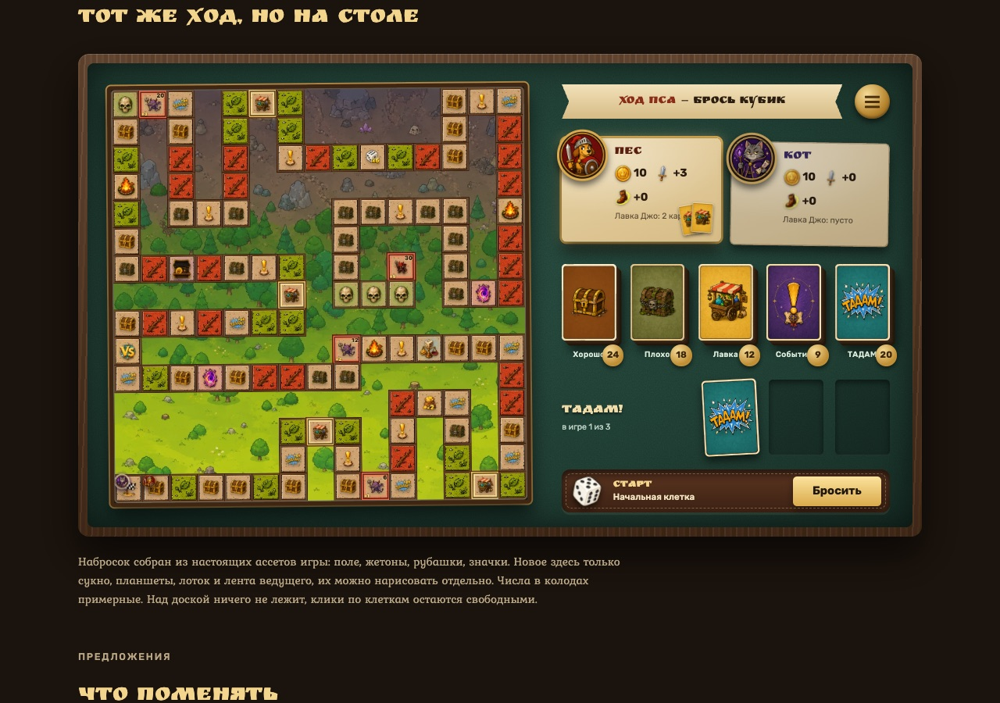
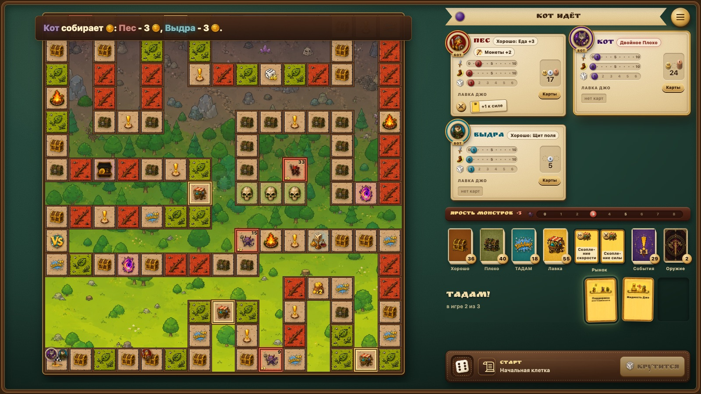
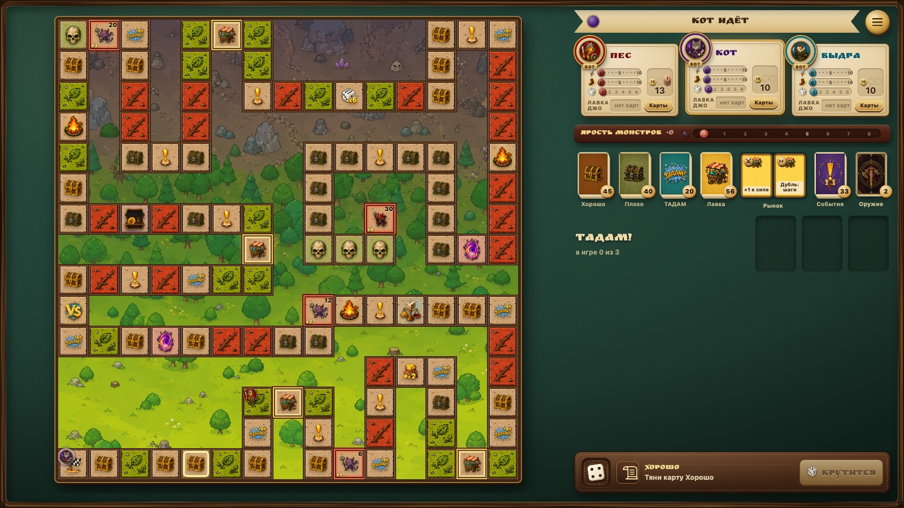
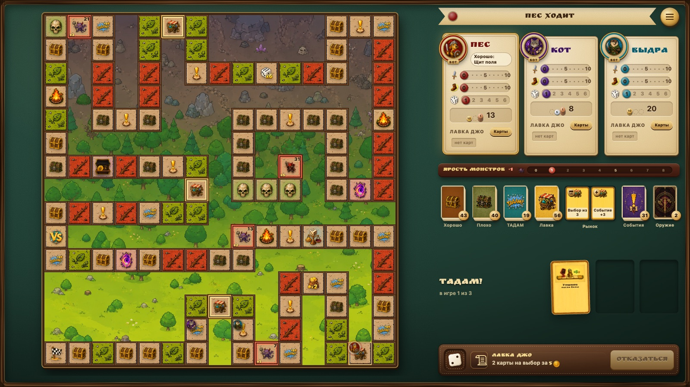

# Настольный стиль: план, как приблизить его к концепту

Art / UI, 12 октября 2026. Задача пользователя через PM: настольный UI всё ещё далёк от концепта, нужен план и работа по нему.

- **Концепт.** Набросок «Тот же ход, но на столе» со страницы разбора UI (11 октября).
- **Сейчас.** Версия 0.1.22: стиль «Настольный», 3 бота, середина партии, экран 1600×900.
- **Рамки.** Меняется только `body[data-ui-style="tabletop"]`. Шаг, который задевает «Классический», ждёт слова пользователя. Правила и баланс не трогаем — это зона GD. Одна доставка на шаг.

## Чем расходятся (самое заметное — первым)

| | Концепт | Сейчас |
|---|---|---|
| **Правая колонка** | Плотная стопка сверху вниз: лента ведущего, планшеты, колоды, ТАДАМ, лоток кубика. Всё одного масштаба | Три пустых отпечатка ТАДАМ занимают полэкрана. Мелкие колоды прижаты к низу, под ними вылезает ряд служебных кнопок |
| **Планшеты** | Светлая бумага, крупный жетон-портрет заходит за угол. Три значка с числами, карты Лавки веером. Активный приподнят, у него золотая кайма | Тёмное дерево, мелкий портрет, имя на ленте. Три трека с цифрами 0–10 очень мелкие и сливаются, карты Лавки — текстовые плашки |
| **Ведущий и кубик** | Лента ведущего вверху справа («Ход Пса — брось кубик»), рядом латунный диск меню. Внизу справа кожаный лоток: кубик, клетка, латунная «Бросить» | Лента, кубик и кнопка — одна длинная полоса под доской слева. Кнопка в ожидании — тёмная плашка |
| **Стол** | Сукно в деревянном борте со скруглёнными углами, тень внутрь, виньетка | Сукно до краёв экрана, без борта. Доска и колонка висят на фоне |
| **Колоды и ТАДАМ** | Колоды размером с карту, число — латунная монета в нижнем углу. ТАДАМ — строка: заголовок, «в игре 1 из 3», три отпечатка размером с карту | Колоды 46×64, число вверху. Отпечатки ТАДАМ 175×245 |
| **Свет и тени** | Один свет слева сверху. Всё на столе отбрасывает мягкую тень вправо вниз | Уже так (шаг К). Оставляем |
| **Шрифты** | Сказочный шрифт для имён, ленты и заголовков | Уже так (шаг Ж). Оставляем |

Трек ярости, треки на планшете, ряды карт по моменту, жетоны монет и рынок появились после концепта по решениям пользователя. Их не убираем, а встраиваем в стиль концепта.

## Шаги

Каждый шаг — одна доставка в `dev`. Самое заметное идёт первым.

1. **О1. Правая колонка: колоды и ТАДАМ в масштабе концепта.**
   - Колоды размером с карту, около 64×90. Число — латунная монета в правом нижнем углу.
   - Колоды и рынок стоят над ТАДАМ.
   - ТАДАМ — одна строка: слева заголовок и «в игре N из 3», справа три отпечатка размером с колоду.
   - Сыгранная карта ТАДАМ ложится в отпечаток. Текст карты — по клику, как сейчас.
2. **О2. Лента ведущего вверху и лоток кубика внизу правой колонки.**
   - В широком настольном виде полоса под доской переезжает в правую колонку.
   - Сверху — пергаментная лента с фразой ведущего и латунный диск меню.
   - Снизу — кожаный лоток: кубик, клетка, латунная кнопка «Бросить».
   - Доска получает всю высоту экрана.
3. **О3. Планшеты из бумаги.**
   - Светлый пергамент с тёмной каймой. Крупный жетон-портрет заходит за левый верхний угол.
   - Имя — шрифтом стола, цветом игрока.
   - Активный планшет приподнят: золотая кайма и тень длиннее.
   - Треки и карман монет перекрашены под светлый фон. Деления крупнее, цифры только на 0, 5 и 10.
4. **О4. Карты Лавки на планшете веером.**
   - В рядах по моменту — мини-карты (лицо Лавки и короткое имя) внахлёст, как в лотке рынка.
   - Печать момента остаётся одна на ряд. Клик по ряду открывает карты игрока.
5. **О5. Стол в деревянном борте.**
   - Сукно лежит в деревянной раме со скруглёнными углами, тень от рамы падает внутрь.
   - Мягкая виньетка к краям. Доска и колонка стоят на сукне с отступом от борта.
6. **О6. Служебное — в меню.**
   - Ряд служебных кнопок под колонкой (справочник, хроника, телефоны, настройки, полный экран) уходит в латунный диск меню из шага О2.
   - Если для этого придётся менять разметку, общую с «Классическим», шаг ждёт слова пользователя.
7. **О7. Пульт в той же бумаге.**
   - Планшет игрока на телефоне в том же пергаменте и с тем же портретом, что на ПК.
   - Лента ведущего — сверху, «Бросить» — латунная.
8. **О8. Средние экраны.**
   - Проверить 1280×800 и 1440×900 и узкий вид до 1199 px.
   - Ничего не налезает на доску, клики по клеткам свободны.

## Что не меняем

- «Классический» стиль.
- Лица карт, поле, правила и числа.
- Решения пользователя по разбору: треки на планшете, ряды по моменту, жетоны 10/5/1, трек ярости, рынок на 2 карты.

## Итог после О1–О8 (версия 0.1.30)

Все восемь шагов в `dev`, по одной доставке на шаг: 0.1.23–0.1.30. Классический стиль не менялся.

| Концепт | Сейчас, 0.1.30 |
|---|---|
|  |  |

**Совпадает с концептом:** стол в деревянном борте, лента ведущего с латунным диском меню наверху колонки, планшеты из пергамента с крупным портретом за углом, колоды размером с карту с монетой-счётчиком, строка ТАДАМ «в игре N из 3», кожаный лоток с латунной «Бросить» внизу, доска во всю высоту. Пульт телефона — тот же пергамент.

**Что ещё расходится:**

- **Планшеты выше и плотнее, чем в концепте.** На них треки, ряды карт по моменту, метки статуса и карман монет — это решения пользователя после концепта. У трёх игроков третий планшет стоит один во втором ряду.
- **Отпечатки ТАДАМ мельче** (72 px против ~90 px), чтобы колонка влезала в экран. Имя карты видно, текст — при наведении. На сенсорном экране наведения нет.
- **Лента ведущего с печатью игрока.** В концепте только текст. Печать оставлена, чтобы видеть, чей ход.
- **В открытом меню** панели «Телефоны» и «Настройки» и выпадающие списки остались тёмными внутри пергамента.
- **Борт** — гладкое дерево без рисунка волокон.
- **До 1199 px** (узкий экран) раскладка прежняя: планшеты сверху, доска под ними, без борта.
- **Колонка на пределе по высоте.** На 1600×900 и 1280×800 лоток помещается в раму. Новый блок в колонку уже не войдёт без ужатия остальных.

## Шаги О9–О12 (задача PM, 12 октября 2026)

Продолжение без решений пользователя. Узкий экран до 1199 px и печать на ленте ведущего не трогаем.

9. **О9. Меню целиком из пергамента.** Панели «Телефоны» и «Настройки», поля и выпадающие списки в открытом меню — на том же листе, тёмными чернилами.
10. **О10. Текст ТАДАМ на сенсорном экране.** Касание карты в отпечатке открывает её крупно.
11. **О11. Планшеты плотнее.** Ближе к концепту, ничего с них не убирая. Три игрока не оставляют третий планшет одного во втором ряду, если на экран влезает лучше.
12. **О12, по желанию. Волокна на борте**, если текстура не утяжелит кадр.

## Итог после О9–О12 (версия 0.1.34)

Четыре шага в `dev`, по одной доставке на шаг: 0.1.31–0.1.34. Классический стиль, узкий экран до 1199 px и печать на ленте ведущего не менялись.

| Концепт | Сейчас, 0.1.34 |
|---|---|
|  |  |

- **О9, 0.1.31.** Открытое меню целиком из пергамента: «Телефоны», «Настройки», поля и выпадающие списки — тёмными чернилами на том же листе.
- **О10, 0.1.32.** Касание карты ТАДАМ берёт её в руки: карта крупно, с текстом. Касание мимо кладёт обратно. На ПК по-прежнему работает наведение.
- **О11, 0.1.33.** Планшеты плотнее: треки тоньше, карман монет по высоте треков, «Лавка Джо» и «Карты» одной строкой, ряды карт по моменту под ней. Длинные имена карт — с многоточием, полное — в подсказке. У трёх игроков три планшета в один ряд. С планшетов ничего не убрано.
- **О12, 0.1.34.** На деревянном борте тонкие прожилки. Неподвижный слой без смешивания цветов, кадр не тяжелеет.

**Что ещё расходится:**

- **Пустое место в колонке у трёх игроков.** Планшеты в один ряд освободили ~150 px между ТАДАМ и лотком. Отпечатки ТАДАМ можно вернуть к размеру концепта (~90 px), но при четырёх игроках планшеты стоят в два ряда, и место нужно им. Следующий шаг — размер отпечатков от числа игроков.
- **Планшеты всё ещё сложнее концепта:** треки, ряды по моменту, метки статуса, карман монет — решения пользователя после концепта.
- **Лента ведущего с печатью игрока** — оставлена, чтобы видеть, чей ход.
- **В полноэкранном режиме** борт гладкий, без волокон.
- **До 1199 px** раскладка прежняя: планшеты сверху, доска под ними, без борта.

## О13–О14 (задача PM, 12 октября 2026; версия 0.1.36)

| Концепт | Сейчас, 0.1.36 |
|---|---|
|  |  |

- **О13, 0.1.35.** Отпечатки ТАДАМ у двух и трёх игроков — 90 px, как в концепте. У четырёх игроков планшеты в два ряда, поэтому отпечатки 72 px, а на невысоком экране 58 px.
- **О14, 0.1.36.** Свободная высота колонки отдана планшетам. Треки, цифры и имена крупнее, «Лавка Джо» больше не переносится. У трёх игроков карман монет стоит строкой под треками, у двух и четырёх — справа. На экране от 880 px в высоту планшеты в один ряд ещё крупнее: портрет 62 px, желобок трека 22 px. Остаток высоты уходит строке ТАДАМ: она встаёт посередине между колодами и лотком, одной дыры над лотком больше нет. Проверено на 2, 3 и 4 игроках при 1600×900 и 1280×800.

**Что ещё расходится:**

- **У двух игроков** вокруг строки ТАДАМ остаётся по ~100 px сукна: двух планшетов мало, чтобы занять колонку.
- **На 1280×800** доска упирается в ширину, и под доской и колонкой остаётся полоса сукна ~120 px. Так было и до О13.
- **Поздняя партия у четырёх игроков.** Метки статуса и ряды карт по моменту делают планшеты выше. Запас по высоте — около 80 px, его хватает примерно на один ряд карт на каждом планшете.
- Планшеты всё ещё сложнее концепта, лента ведущего с печатью игрока, борт гладкий в полноэкранном режиме, узкий экран до 1199 px прежний — как в итоге выше.
